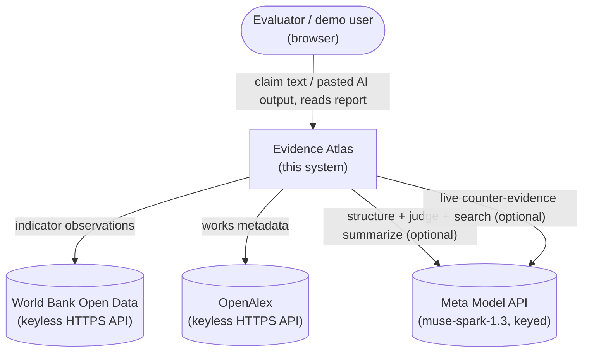
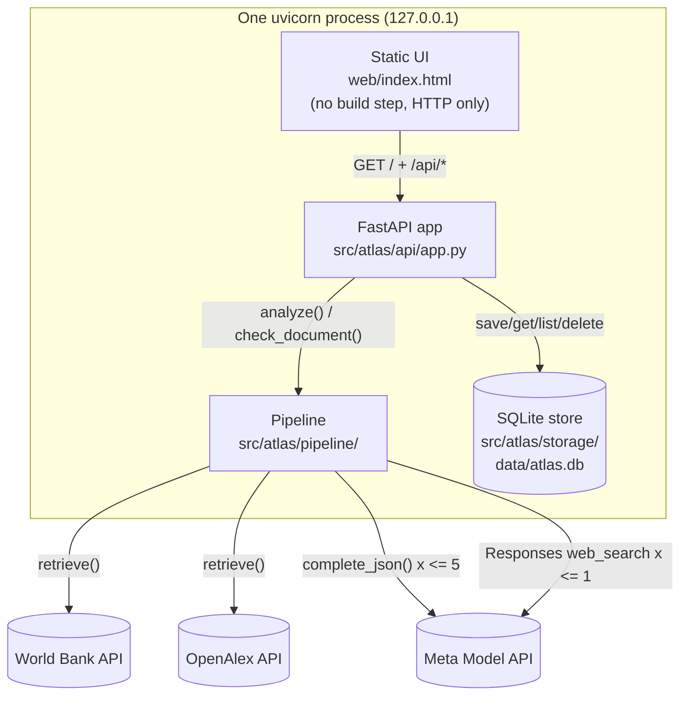
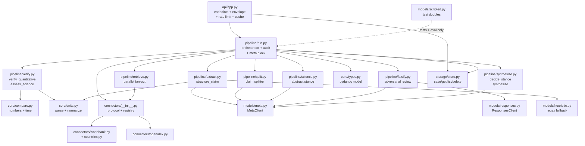
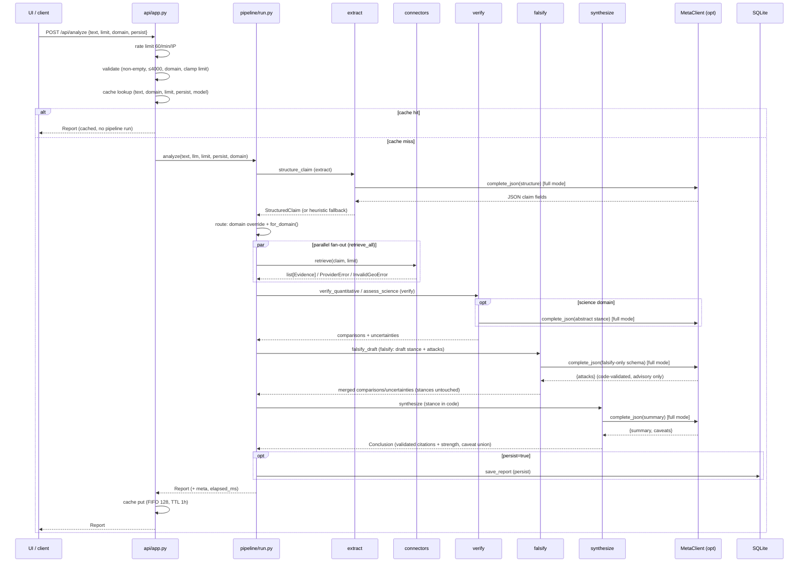
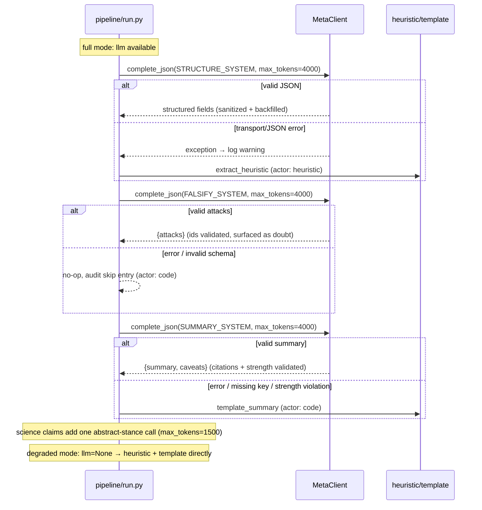
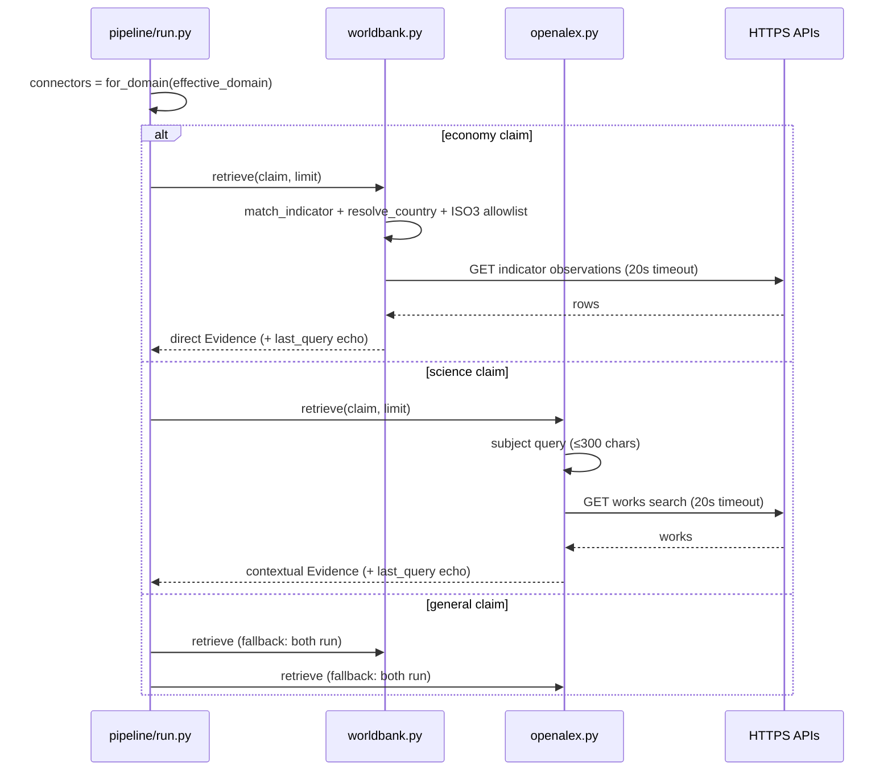
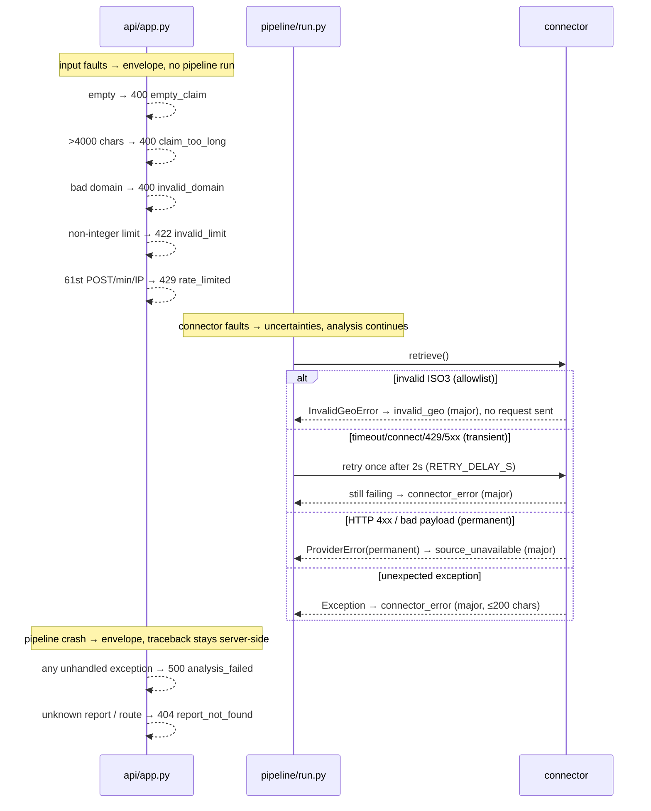

# Architecture

Evidence Atlas is a **Python monolith in one process**: FastAPI serves a
JSON API and a static single-page UI; a staged pipeline turns a claim into
a traceable report; SQLite persists reports; two HTTP connectors reach
public sources; one model client reaches the Meta Model API.

Version described here: **0.4.0** (`APP_VERSION` in `pipeline/run.py`,
surfaced as `version` in `GET /api/status` and `meta.app_version`).
The ShipCheck sidecar (`POST /api/check`, `pipeline/split.py`, web
counter-evidence) is intake + doubt around the unchanged 7-stage
per-claim core.

## C4 L1 — System context

The system is single-user and localhost-only. Without a model key it
degrades deterministically (heuristic extraction + template summaries);
the verification core is identical in both modes.

## C4 L2 — Containers (all in one process)

| Container | Path | Responsibility |
|---|---|---|
| UI | `web/index.html` | One static page: single-claim + batch sidecar modes, roll-up, per-claim cards, recent-analyses history with delete. Never imports the pipeline. |
| API | `api/app.py` | Endpoints (`/api/analyze`, `/api/check`), unified error envelope, rate limit, identical-text cache (analyze only), static mount. |
| Pipeline | `pipeline/` | ShipCheck intake (`split.py`) + seven audited per-claim stages: extract → route → retrieve → verify → falsify → synthesize → persist. |
| Store | `storage/store.py` + `data/atlas.db` | One-table SQLite persistence. Reads never create files. |

## C4 L3 — Components

### Component table

| Component | Path | Responsibility |
|---|---|---|
| Types | `core/types.py` | Pydantic domain model: claim, evidence, comparison, uncertainty, conclusion, audit, report. Five stances incl. `not_assessable`. |
| Units | `core/units.py` | Deterministic parsing/normalization of quantities, scales, currencies, temperatures, decimal commas. |
| Compare | `core/compare.py` | Deterministic numeric + time comparison; strict comparability; 2% tolerance default (`DEFAULT_REL_TOLERANCE`); claimed-precision resolution parsing (`implied_resolution`); absolute-materiality guides. |
| Connectors | `connectors/` | `SourceConnector` protocol + `REGISTRY`; `worldbank.py` (+ ISO3 allowlist, `countries.py`), `openalex.py` (+ abstract fetch/reconstruction). `ProviderError(transient)` / `InvalidGeoError`. `last_query` echo per retrieve. |
| Models | `models/` | `meta.py` (`MetaClient`: lazy OpenAI SDK, `reasoning_effort` passthrough, strict `json_schema` decoding, per-call `last_usage` + seq), `responses.py` (`ResponsesClient`: Responses API + `web_search`, code-validated `url_citation`s), `heuristic.py` (regex fallback), `scripted.py` (test doubles). |
| Split | `pipeline/split.py` | ShipCheck intake: model-first splitting under a strict schema (verbatim spans only, deduped, capped at 8) with deterministic sentence-split fallback. |
| Extract | `pipeline/extract.py` | Claim structuring via LLM with heuristic fallback; model output sanitized (unit allowlist, finite floats, year-like drop, 20-item caps); verbatim `raw` spans + deterministic span recovery; LLM gaps backfilled deterministically. |
| Retrieve | `pipeline/retrieve.py` | Parallel connector fan-out (`ThreadPoolExecutor`); deterministic ordering; per-connector retry-once-transient + error isolation. |
| Verify | `pipeline/verify.py` | `verify_quantitative` (economy: precision rule, materiality disclosure, methodological codes) and `assess_science` (bibliographic); `detect_claim_shape` (opinion/compound flags); code-only. |
| Science | `pipeline/science.py` | Additive abstract-stance assessment (one bounded model call over top-3 abstracts); non-verifying by construction. |
| Falsify | `pipeline/falsify.py` | Advisory adversarial self-review: schema-constrained attacks + one live-web counter-evidence pass (default on, `ATLAS_WEB_FALSIFY=0` disables), all validated by code and surfaced as doubt; never moves stances; degraded-safe no-op. |
| Synthesize | `pipeline/synthesize.py` | Deterministic stance rules (`decide_stance`, incl. precision + compound caps); `partial_coverage` caveat for half-checked conjunctions; citation validation; summary-strength validation; caveat union; optional LLM summary rewrite. |
| Run | `pipeline/run.py` | Orchestrator: `analyze()` (7 audited stages, domain override, uncertainty dedupe, connector error isolation, per-stage usage accounting, `meta` block, persistence) + `check_document()` (split → per-claim reports → stance roll-up; one failure never kills the batch). |
| Store | `storage/store.py` | SQLite: save/get/list/delete reports. Init-on-write; reads are create-free. |
| API | `api/app.py` | FastAPI app; status/analyze/check/reports/delete endpoints; envelope; 60/min/IP rate limit (shared bucket); 128-entry 1h cache (analyze only); static mount. |

## Sequence — analysis (`POST /api/analyze`)

## Sequence — model interaction (full vs degraded)

At most 5 model calls per single-claim analysis (structure +
abstract-stance + falsify + web counter-evidence + summary;
science-only for abstracts). `tests/e2e/test_pipeline_offline.py`
asserts the offline call count on its covered paths (3 on the economy
path); the live budget above is by construction (one call per stage,
retries only on transient failures). The batch path adds 1 split call
plus a full run per sub-claim (cap 8).
All Chat Completions calls use strict `json_schema` decoding (shape
guaranteed; honesty still validated in code) and `temperature=0`; the
Responses web-search call is free-form + code-validated and sets no
temperature. Structure/falsify/summary/split use `max_tokens=4000`,
abstracts `1500`, web pass `2000` output. Falsify/abstract/split calls
pass `reasoning_effort="low"` (default depth truncated them live);
structure/summary stay at default depth. Per-stage token usage lands
in `meta.usage_*` (`usage_split` on the batch roll-up).

## Sequence — retrieval (per connector)

`general`-tagged connectors run only for `general` claims, so domain
claims never collect cross-domain noise. Audit `retrieve` steps record
`status=ok|error|invalid_geo`, `count`, and the echoed `query`.

## Sequence — error / fallback paths

## Data model (`core/types.py`)

`Report` is the unit of output and persistence:

- `report_id`, `created_at`, `elapsed_ms` (wall ms for `analyze()`).
- `claim: StructuredClaim` — `raw_text`, `domain` (economy/science/general),
  `claim_type`, `subject`, `indicator`, `entities`, `quantities[]`,
  `time_refs[]`, `geo_refs[]`, `conditions[]`, `context_notes`,
  `extraction_actor` (code/model/heuristic), `extraction_model`.
- `evidences[]: Evidence` — `connector`, `source_name`, `source_url`,
  `source_kind` (primary/secondary/reproduction), `evidence_kind`
  (direct/contextual), `locator`, `excerpt`, `payload` (unit, year, value,
  query echo, ...).
- `comparisons[]: Comparison` — `metric`, `verdict`
  (consistent/contradicts/inconclusive/not_comparable), `rel_diff_pct`,
  `tolerance_rule`, `within_tolerance`, `notes`, `actor` (always code).
- `uncertainties[]: Uncertainty` — `code`, `description`, `severity`
  (blocking/major/minor). Deduped on (code, description).
- `conclusion: Conclusion` — `stance` (5 values), `summary`,
  `support_comparison_ids[]`, `contradict_comparison_ids[]`, `caveats[]`
  (code ∪ model), `actor`, `model`.
- `audit[]: AuditStep` — `step`, `actor`, `started_at`, `ended_at`,
  `duration_ms`, `detail`. Order: extract → route → retrieve* → verify →
  falsify → synthesize → persist?.
- `limitations[]` — fixed 4-item honesty block (`LIMITATIONS` in `run.py`).
- `meta{}` — `app_version`, `model` (name or null), `temperature` (0),
  `max_tokens` (4000), `tolerance` (0.02), `default` (limit default 5),
  `prompt_version` ("4": strict decoding schemas on all model calls),
  `input_sha256`, `usage_extract`, `usage_science`, `usage_falsify`,
  `usage_summary` (per-stage token accounting; `usage_split` lives on
  the batch roll-up instead).

SQLite (`storage/store.py`): one `reports` table
`(report_id PK, created_at, claim_text, stance, report_json)`.
`save_report` does `INSERT OR REPLACE` after `init_db` (init-on-write);
`get_report`/`list_reports`/`delete_report` first check
`_has_reports_table` and return empty without creating anything.

## Execution flow

`POST /api/analyze {text, limit, domain, persist}` → `analyze()`:

1. **extract** — `structure_claim`: LLM JSON (actor `model`) or heuristic
   (actor `heuristic`). Model output is sanitized (unit allowlist, finite
   floats, year-like quantities dropped, 20-item list caps). Years/countries/
   quantities the LLM drops are backfilled from regex so explicit text is
   never silently lost.
2. **route** — `for_domain` on the effective domain. An explicit
   `domain` override replaces the extracted domain and is recorded in the
   audit detail (`domain_override=A->B`). Economy→worldbank,
   science→openalex, general→both. Connectors tagged `general` are
   fallbacks only.
3. **retrieve** — each connector returns `Evidence` with source kind
   (secondary for both MVP sources) and evidence kind (World Bank values
   `direct`, OpenAlex metadata `contextual`). `last_query` is echoed into
   the audit detail. `InvalidGeoError` → `invalid_geo` uncertainty (no
   request sent); `ProviderError(transient)` → `connector_error`;
   `ProviderError(permanent)` → `source_unavailable`; anything else →
   `connector_error` with ≤200 chars of text. Analysis continues.
4. **verify** — code-only. Economy/general: per-quantity same-unit matching,
   same-period gating, `compare_numbers`. Science: year-match checks plus a
   mandatory `metadata_only` uncertainty; general claims with no numeric
   comparisons also get the science assessment. `detect_claim_shape` flags
   opinions/non-claims (`opinion_or_nonclaim`) and compound claims
   (`compound_claim`, detect+disclose only). Nothing here calls a model.
5. **falsify** — advisory only. The model attacks the draft through a
   falsify-only schema (code validates target ids/enums), then one live
   web-search pass hunts counter-evidence (code validates every
   `url_citation`); survivors surface as doubt. Never moves stances;
   degraded-safe no-op; `ATLAS_WEB_FALSIFY=0` disables the web pass.
6. **synthesize** — `decide_stance` rules (see below), then the
   `partial_coverage` caveat when part of the text went unchecked; LLM
   summary rewrite attempted only if a client is available, else the
   deterministic template. Model citations to unknown `[cmp_*]` ids are
   stripped (logged); blocking/major template caveats are always
   retained (caveat union).
7. **persist** — report JSON saved to SQLite when `persist=true`;
   report id returned. Skipped (and absent from the audit) otherwise.

`POST /api/check {text (≤12000 chars), limit, domain, persist}` →
`check_document()`: split into ≤8 verbatim sub-claims, run `analyze()`
per sub-claim (each persisted and re-fetchable), return full reports +
stance roll-up. One failing sub-claim becomes an error entry, never a
batch failure.

Every stage appends an `AuditStep{step, actor, detail, duration_ms}`; the
UI renders `CODE` / `MODEL` / `HEURISTIC` badges from it.

## Stance rules (`synthesize.decide_stance`)

Checked in order; the first match wins:

1. `opinion_or_nonclaim` uncertainty present, or claim empty of assessable
   content (zero quantities, times, geos + `claim_type == "other"`) →
   `not_assessable`.
2. Any **verifying** `contradicts` → `contradicted`.
3. Any verifying `consistent` → `supported` (`partially_supported` if a
   blocking uncertainty exists).
4. Only non-verifying consistency (`time_compatibility`,
   `publication_year_match`) → `partially_supported`.
5. Otherwise → `unverifiable`.

Verifying metrics are numeric comparisons on same-unit, same-period data.
Bibliographic year matches can never yield `supported` by construction.

## Comparability contract (`core/compare.py`)

- Unknown unit on either side → `not_comparable`, no number emitted.
- Mismatched units → `not_comparable`, except temperature (converted).
- Non-overlapping periods → values are not compared; `period_mismatch`
  uncertainty recorded instead.
- Bare claim numbers match `count` evidence only, flagged with
  `unit_assumed_from_context` on both comparison and uncertainties.
- Year-like numbers (4 digits, 1000–2100) are time references, never quantities.
- A discrepancy is a measured difference with a methodology caveat,
  never a verdict of falsehood.

## Error handling

- Connector exceptions → coded uncertainties (`invalid_geo`,
  `connector_error`, `source_unavailable`); pipeline continues.
- LLM transport/JSON errors → silent fallback to heuristic/template;
  the audit trail records which actor actually produced the output.
- API validates input (non-empty, ≤4000 chars, `auto|economy|science|general`
  domain, limit clamped 1–10); all failures use the unified envelope
  `{"error": {"code", "message", "request_id"}}`.
- Storage uses `INSERT OR REPLACE` on report id; reads return 404 when missing.
- Identical `(text, domain, limit)` analyses are cached (128 entries FIFO,
  1h TTL); a hit skips the pipeline entirely.

## Persistence

Single SQLite file (`data/atlas.db`, overridable via `ATLAS_DB`):
one `reports` table (id, timestamp, claim text, stance, full JSON).
Init-on-write: the directory/table are created only by `save_report`.
No migrations needed at this scale; no concurrent-write requirements.
No TTL on stored reports — delete explicitly.

## Configuration

Environment only: `MODEL_API_KEY` (enables full mode),
`MODEL_API_BASE_URL` (default `https://api.meta.ai/v1`),
`MODEL_API_MODEL` (default `muse-spark-1.3`), `ATLAS_DB`.
See `.env.example`. No secrets are ever written to the repo or the database.
