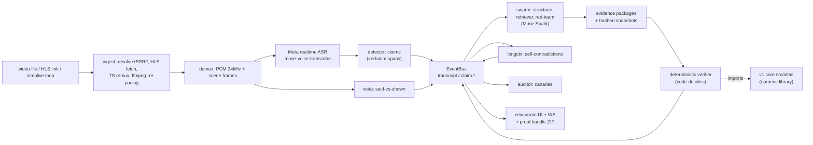

# Atlas Live architecture (brief)

Atlas Live (`live/`) is the product: a real-time agent newsroom. The
v1 core (`src/atlas/`, ShipCheck v0.4.0, HISTORICAL) survives as its
deterministic numeric library (units, comparisons, verdict math) —
Atlas imports it, never the reverse.

Key contracts:

- **Model proposes, code disposes** ([AGENTS.md](AGENTS.md)): verdicts
  come only from the deterministic verifier over valid evidence
  packages (quote-must-exist, number re-extraction, 2% tolerance,
  scale guard, temporal alignment, primary-beats-secondary).
- **Bus log is the run**: `data/runs/*.jsonl` (+ `.summary.json`)
  replays verbatim (`GET /replay`, `WS /ws?replay=`); the UI never
  sees anything the log doesn't contain.
- **Proof is offline**: every verdict ships hashed snapshots;
  `live/bundle/verify_bundle.py` re-verifies without network or key.
- **Link ingest never feeds URLs to ffmpeg**: SSRF-guarded Python
  fetch → local materialize → (TS→MKV remux) → existing pipeline.
- **Vision is offline-path**: scene frames → Muse vision reads →
  code xcheck vs speech numbers (±15 s window).

Module map: `live/ingest/` (resolve, turbo, hlsfetch, tsdemux,
demux, simstream), `live/oido/` (ASR), `live/detector/`,
`live/orchestrator/` (bus, states), `live/swarm/`, `live/evidence/`,
`live/verifier/`, `live/vista/`, `live/longctx/`, `live/skeptic/`
(advisory), `live/auditor/`, `live/editor/` (cards), `live/replay/`,
`live/report/`, `live/bundle/`, `live/server/` + `live/ui/`,
`live/eval2/` (benchmark v2), `live/synthqa/`, `live/material/`.
